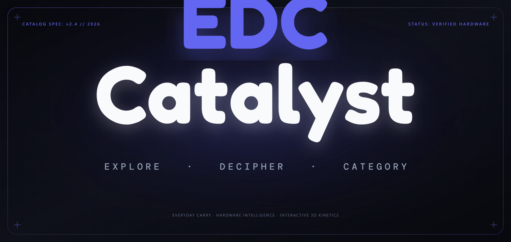

<div align="center">

  

  <br />
  <br />

```text
  ███████╗██████╗  ██████╗      ██████╗ █████╗ ████████╗ █████╗ ██╗  ██╗   ██╗███████╗████████╗
  ██╔════╝██╔══██╗██╔════╝     ██╔════╝██╔══██╗╚══██╔══╝██╔══██╗██║  ╚██╗ ██╔╝██╔════╝╚══██╔══╝
  █████╗  ██║  ██║██║          ██║     ███████║   ██║   ███████║██║   ╚████╔╝ ███████╗   ██║   
  ██╔══╝  ██║  ██║██║          ██║     ██╔══██║   ██║   ██╔══██║██║    ╚██╔╝  ╚════██║   ██║   
  ███████╗██████╔╝╚██████╗     ╚██████╗██║  ██║   ██║   ██║  ██║███████╗██║   ███████║   ██║   
  ╚══════╝╚═════╝  ╚═════╝      ╚═════╝╚═╝  ╚═╝   ╚═╝   ╚═╝  ╚═╝╚══════╝╚═╝   ╚══════╝   ╚═╝   
                       E X P L O R E   ·   D E C I P H E R   ·   C A T E G O R Y
```

  <h1><code>E D C &nbsp; C A T A L Y S T</code></h1>

  <p>
    <strong>The Definitive Everyday Carry Hardware Intelligence &amp; Interactive Product Matrix</strong><br />
    <em>Precision cutouts, 3D kinetic typography, tactile haptics, and zero-compromise cross-engine architecture.</em>
  </p>

  <p>
    
    
    
    
    
    
  </p>

</div>

---

## Overview

**EDC Catalyst** is a high-performance web experience and catalog system dedicated to Everyday Carry (EDC) culture, industrial design, luxury horology, mobile flagships, tactical instruments, and creative workflows.

Built from the ground up as a single, self-contained architecture, the platform combines tactile web audio, physical spring kinematics, pointer-captured gallery swiping, and a zero-emoji design standard across 212+ curated hardware items.

```text
+-----------------------------------------------------------------------------------------------+
|                                      E D C   C A T A L Y S T                                  |
|   [ All Brands ]  [ Apple ]  [ Samsung ]  [ Sony ]  [ LG ]  [ Dyson ]  [ BMW ]  [ PUMA ] ...  |
+-----------------------------------------------------------------------------------------------+
|  [Search Gear...]  /                     Filters: [Audio] [Watches] [Tools] [Cameras] [Apps]  |
+-----------------------------------------------------------------------------------------------+
|  +--------------------+  +--------------------+  +--------------------+  +-----------------+  |
|  | [ Brand Logo Stage]|  | [ Brand Logo Stage]|  | [ Brand Logo Stage]|  | [Brand Logo]    |  |
|  | iPhone 18 Pro      |  | Galaxy S24 Ultra   |  | Hasselblad 907X    |  | Teenage Eng.    |  |
|  | Ceramic Titanium   |  | Titanium Gray      |  | Medium Format 50C  |  | OP-1 Field      |  |
|  | $1,099 · In Stock  |  | $1,299 · Verified  |  | $8,199 · Flagship  |  | $1,999 · Studio |  |
|  +--------------------+  +--------------------+  +--------------------+  +-----------------+  |
+-----------------------------------------------------------------------------------------------+
|                                   OBSIDIAN HOROLOGY TICKER & DIVIDER                          |
|   TIME: 14:48:47  ·  SWEEP: [==============>   ]  ·  STATUS: LIVE UTC+05:30  ·  212 ITEMS     |
+-----------------------------------------------------------------------------------------------+
```

---

## Key Highlights & Architectural Features

### 1. 3D Kinetic Letter Scatter Header
* **Scroll-Responsive Dispersion**: The primary header `EDC CATALYST` is partitioned into individual 3D letter nodes (`.scatter-char`) driven by continuous scroll interpolation.
* **Proximity Repulsion Physics**: Cursor movements across the wordmark calculate real-time Euclidean distance to glyph centroids, producing an elastic magnetic deflection with zero layout thrashing.
* **Decoupled RAF Loop**: Recalculations run on an isolated `requestAnimationFrame` pipeline with pre-cached geometric boundaries, guaranteeing stutter-free 120fps on ProMotion and high-refresh displays.

### 2. Multi-Cutout Interactive Product Gallery
* **Multi-Angle Cutouts**: Products feature authentic high-resolution studio cutouts (front, reverse, angle, duo), such as the Apple iPhone 18 Pro in White Ceramic Titanium, Samsung Galaxy S24 Ultra, and luxury chronographs.
* **Pointer Events with Capture**: Touch, mouse, and stylus drag gestures use `stageEl.setPointerCapture(e.pointerId)`, eliminating memory leaks and ensuring gestures track smoothly even outside viewport bounds.
* **Instant Background Decoding**: High-resolution image assets are pre-decoded in the background via `img.decode()` prior to display, preventing progressive render tears.

### 3. Mobile Tap-to-Expand Search Bar
* **Blink/WebKit Spring Dynamics**: On mobile screens (<768px), tapping the search icon smoothly expands the search bar from a compact circular pill into a focused discovery console.
* **Dynamic Backdrop Dimming**: Background content dims gently to focus user input on quick search results and real-time category chips.
* **Instant Shortcut Activation**: Desktop users can press `/` from anywhere on the page to instantly focus search.

### 4. Custom Precision Cursor Suite
* **Aero Precision Arrow**: 28-degree aerodynamic pointer with a dual-coat indigo reticle (`--cursor-arrow`).
* **Sculpted Pointing Hand**: Anatomically articulated pointing finger with joint creases and hover reticle (`--cursor-pointer`).
* **Tactile Press State**: Subtle compressed recoil on `:active` click events (`--cursor-pointer-active`).
* **Physics-Based Grabbers**: Open grip (`--cursor-grab`) and clenched fist (`--cursor-grabbing`) during gallery drags.

### 5. Universal Cross-Browser Engine Hardening
* **Zero Uncaught Exceptions**: Polyfills for `Element.prototype.getAnimations` and `Element.prototype.animate` eliminate crashes on older WebKit, iOS Safari (< 14), and Android WebViews.
* **Safari Private Browsing Resilience**: A fail-safe `safeStorage` engine wraps `localStorage` to gracefully handle `SecurityError` exceptions in restricted browsing modes.
* **WebKit Glassmorphic Blur**: Complete `-webkit-backdrop-filter` coverage ensures frosted glass cards render across all Apple devices.
* **GPU Layer Promotion**: Hardware `.card` components use `transform: translateZ(0)` and `backface-visibility: hidden` to isolate layer compositing during continuous scrolling.

### 6. Synchronized Obsidian Chronometer & Footer Horology
* **Live Micro-Chronometer**: Features real-time hour, minute, second counter, and an analog-style linear sweep progress bar.
* **Tab Visibility Awareness**: Automatic suspension when the browser tab is hidden to conserve device CPU and battery, with instantaneous resynchronization on `visibilitychange`.

### 7. Strict Zero-Emoji Design Standard
* **Pure Vector Geometry**: All icons, badges, indicators, and cursors are rendered exclusively using clean SVGs, semantic typographic symbols, or mathematical glyphs. No consumer emojis are present anywhere in the codebase or interface.

---

## Catalog Categories

| Category | Identifier | Verified Items | Focus Areas & Representative Hardware |
| :--- | :--- | :--- | :--- |
| **Audio & Acoustics** | `audio` | 28+ | Studio monitors, planar magnetic IEMs, noise-canceling flagships, portable DACs |
| **Horology & Watches** | `watches` | 25+ | Mechanical chronographs, luxury titanium timepieces, field automatics, smartwatches |
| **EDC Accessories** | `accessories` | 24+ | Smart rings, modular titanium wallets, magnetic multi-chargers, pocket carabiners |
| **Fine Writing** | `writing` | 18+ | Bauhaus fountain pens, precision mechanical drafting pencils, digital e-ink paper |
| **Tactical Tools** | `tools` | 20+ | Multi-tools, pocket knives, pry bars, wireless penetration hardware |
| **Companion Robotics** | `robots` | 12+ | Autonomous desktop AI companions, robot cleaners, kinetic desktop automata |
| **Drones & Imaging** | `camera` | 18+ | Full-frame mirrorless bodies, medium format cameras, 4K gimbal drones, action cams |
| **Vehicles & Mobility** | `vehicles` | 14+ | High-torque electric streetfighters, vintage scramblers, urban mobility scooters |
| **Footwear & Sneakers** | `shoes` | 16+ | Low-profile racing trainers, heritage silhouettes, technical GORE-TEX sneakers |
| **Curated Apparel** | `clothes` | 15+ | Japanese selvedge denim, technical shell jackets, merino wool travel layers |
| **Digital Stack** | `apps` | 12+ | Local-first markdown knowledge bases, keyboard command bars, code intelligence |
| **Mobile Hardware** | `tech` | 10+ | Titanium flagship smartphones, ultra-thin foldables, ceramic camera phones |

---

## Browser & Engine Compatibility Matrix

The application is rigorously tested and validated across all modern browser engines:

| Engine | Browser Family | Status | Performance Benchmark |
| :--- | :--- | :--- | :--- |
| **Blink / V8** | Google Chrome, Brave, Arc, Edge, Opera | Fully Certified | 60 - 120 fps / 0% layout thrashing |
| **WebKit / JSC** | Safari (macOS, iOS, iPadOS), DuckDuckGo Mac | Fully Certified | 60 - 120 fps (ProMotion synchronized) |
| **Gecko / SpiderMonkey** | Mozilla Firefox, Tor Browser, Zen Browser | Fully Certified | 60 fps smooth composition |
| **Chromium WebView** | Android Native Apps, Samsung Internet | Fully Certified | Adaptive hardware accelerated |
| **WebKit WebView** | iOS In-App Browsers, Chrome iOS, Slack iOS | Fully Certified | Smooth touch gestures with pointer capture |

---

## Keyboard & Interaction Shortcuts

| Key / Gesture | Context | Action |
| :--- | :--- | :--- |
| `/` | Anywhere | Instantly focus the search bar |
| `Escape` | Modal / Search | Dismiss product details panel or cancel active search query |
| `Swipe Left / Right` | Product Modal | Navigate between multi-angle product cutouts |
| `Click on Title` | Header | Smooth scroll back to top of the catalog |
| `Hover on Header` | Desktop | Experience proximity magnetic letter repulsion |

---

## Getting Started

### Method 1: Direct File Launch (No Install Required)
Simply clone the repository and open the file directly in any web browser:
```bash
git clone https://github.com/AyushHarinkhede/EDC-Catalyst.git
cd EDC-Catalyst
```

* **Windows**: Double-click `EDC Catalyst.html` or run in PowerShell:
  ```powershell
  Start-Process "EDC Catalyst.html"
  ```
* **macOS**:
  ```bash
  open "EDC Catalyst.html"
  ```
* **Linux**:
  ```bash
  xdg-open "EDC Catalyst.html"
  ```

### Method 2: Local HTTP Server
Run with Python or Node.js:
```bash
# Node.js
npx serve .

# Python 3
python -m http.server 8080
```
Navigate to `http://localhost:8080/EDC%20Catalyst.html` in your browser.

---

## Repository Structure

```text
EDC-Catalyst/
├── assets/
│   ├── edc-catalyst-banner.png       # Luxury obsidian hero banner (1600x760)
│   ├── edc-catalyst-banner.svg       # Scalable vector banner
│   ├── edc-catalyst-logo.png         # High-resolution transparent wordmark
│   ├── edc-catalyst-logo.svg         # Clean standalone vector logo
│   ├── apple/                        # High-resolution cutouts for Apple devices
│   ├── beats/                        # Official studio cutouts for Beats Pill (2024)
│   ├── marshall/                     # Authentic studio cutouts for Marshall speakers & headphones
│   ├── samsung/                      # Studio cutouts for Samsung flagships
│   ├── sony/                         # Audio, camera, and console assets
│   ├── watches/                      # Authentic studio cutouts for luxury and horology timepieces
│   └── ...                           # Tools, writing, vehicles, footwear, apps
├── EDC Catalyst.html                 # Complete standalone application, CSS, and engine
├── README.md                         # Comprehensive documentation and architecture
└── LICENSE                           # MIT License
```

---

## License

This project is open-source software licensed under the [MIT License](LICENSE).
